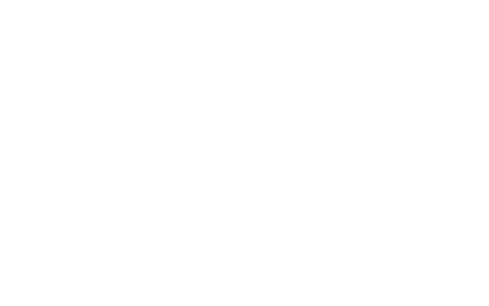
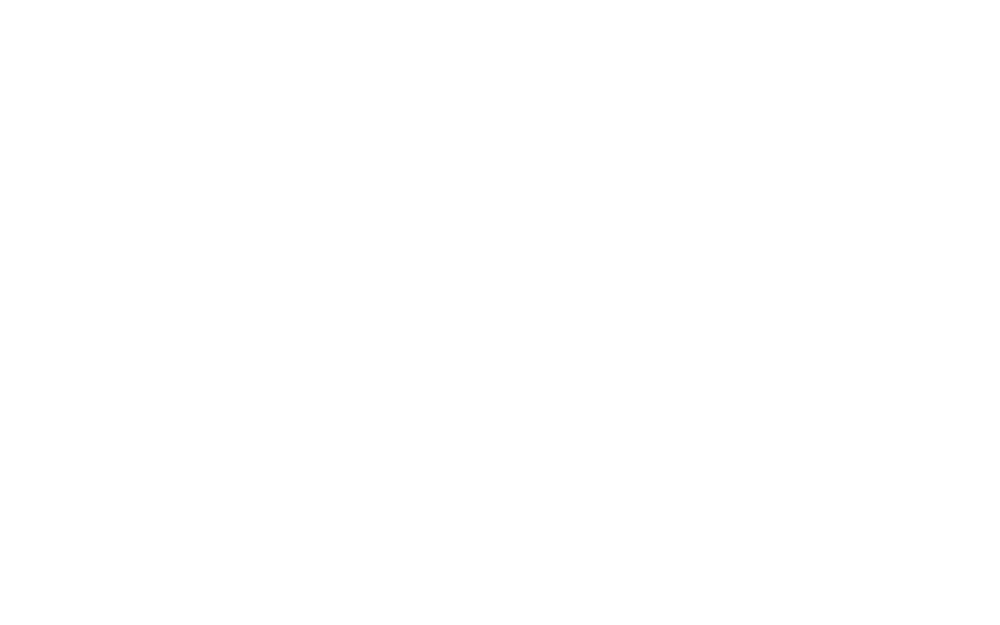
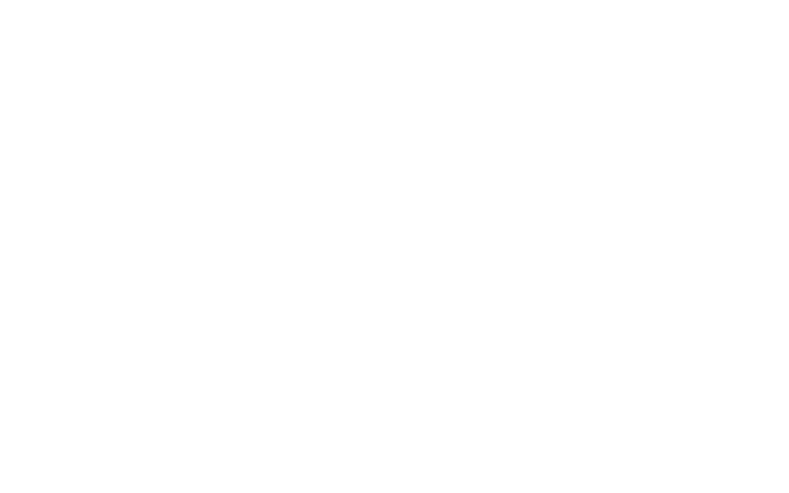

# 只读可视化：启动前检查

界面沿用 `BPX_test` 的关节反馈表、姿态骨架、反馈 / 目标曲线和官方参数对照，
适配本工程的统一 DreamWaQ 模型，并增加独立的“启动前检查”页。

以下截图来自本工程实际 Tk 窗口，使用 DEMO 模拟反馈和当前 ONNX 模型，
不是实机测量。截图字号为 20，默认启动字号仍为 32。

## 启动

在本机图形桌面的终端中运行：

```bash
cd ~/BPX_DreamWaQ
conda activate bpx-real
python scripts/visualize.py
```

`scripts/monitor.py` 和 `scripts/sim2real.py monitor` 提供同一个窗口。
VS Code 的“运行和调试”中也可选择 **BPX: 只读启动前检查** 后按 F5，
该配置显式使用 `bpx-real`，不受默认训练解释器影响。

```bash
# 模拟反馈，使用当前 ONNX 权重；不连接机器人或读取真实手柄
python scripts/visualize.py --demo

# 只看模拟反馈和姿态，不加载模型
python scripts/visualize.py --demo --no-policy

# 指定配置 / 模型
python scripts/visualize.py --config configs/sim2real/local.runtime.toml \
    --policy policies/other.onnx

# 枚举或指定电脑手柄
python scripts/visualize.py --list-gamepads
python scripts/visualize.py --gamepad-index 0
```

控制与监控共用配置选择规则：优先读取 `local.runtime.toml`，不存在则使用模板。
模板和模型路径见 [部署说明](SIM2REAL.md)。

## 启动前检查页



打开窗口后自动在后台检查模型和依赖，无需连接机器人。
“重新检查模型（不连接）”可重新读取当前模型文件并试推理。
`--no-policy` 会跳过模型加载。更换 TOML 配置或模型路径后需重启窗口。

| 检查项 | 查看内容 |
| --- | --- |
| 数据来源 | SDK 只读反馈、DEMO 或录制回放；结束或停更时撤销当前状态 |
| 模型检查 | 文件、SHA256、float32 输入输出尺寸、有限输出和预热耗时 |
| SDK 依赖 | 当前解释器是否安装 SDK；检查本身不创建 SDK 对象 |
| 观测与控制契约 | 450 维、H=10、50 Hz 策略 / 100 Hz 部署发送 |
| 策略 → SDK 通道 | 12 个通道映射，与参数页逐关节对应 |
| 12 关节反馈 | 当前 q / dq 完整性、joint 数据年龄 |
| IMU 与姿态 | 数据年龄、四元数模长、RPY 与角速度是否有效 |
| 电脑手柄 | 当前 vx / vy / wz；有效零输入与手柄缺失分别显示 |
| 策略预览 | 当前固件状态、输入和推理结果，暂停时显示原因 |

软件模型检查通过不会把反馈项改为通过。DEMO / 录制明确标注来源，
会话结束、数据过期或无效时，反馈和预览项不再显示为有效。

## 实时反馈与姿态页



填写机器人 IP，点击“连接只读反馈”。窗口只创建 `RequestRobotState`，
不创建运动控制对象，不发送速度、关节、起身、阻尼或标零命令。
SDK 的连接过程本身可能执行时间同步。

| 列 | 含义 |
| --- | --- |
| 关节 / P,S | 策略索引 P 和配置的 SDK 通道 S，从 0 开始 |
| SDK q | 当前选择的 SDK 通道原始角度 |
| 官方 q | 按官方通道定义读取的角度 |
| 当前 q / dq | 应用 sign / offset 后的模型角度和角速度 |
| SDK 力矩* | 原始反馈，单位以固件说明为准 |
| action | 当前统一 DreamWaQ 模型输出 |
| 策略 q | `q_default + 0.5 × action`，未接管混合、未执行 |
| SDK 目标 | 转回 SDK 坐标的预览目标，未发送 |
| 目标−反馈 | 预览目标与实测角度的差，不代表执行后的跟踪误差 |

角度单位 rad、角速度 rad/s，四元数按 xyzw，RPY 按 ZYX 解算并显示为度。
灰色骨架对应官方原始解释，青色对应当前标定后的反馈，橙色对应未执行目标。
选择关节可查看最近 10 秒曲线；字号可调，表格支持水平与垂直滚动。

策略预览沿用部署的 Stand / Walk / STOPPING 指令路由，三种状态共用一个模型。
趴卧、起身、其他步态或手柄缺失时可能暂停预览，仍可检查关节与姿态。
DEMO 青色骨架是模拟反馈，不会跟随橙色目标执行行走。

## 官方定义 / 当前配置页



对照官方示例与当前训练 / 部署参数，逐关节检查 SDK 通道、sign、offset、
模型范围和 kp / kd。该页同时列出模型、runtime 和标定文件路径。
模型范围仅用于对照；示例参数不会覆盖当前配置。

## 录制与离线复查

```bash
python scripts/visualize.py --output outputs/sim2real/preflight-01.jsonl
python scripts/visualize.py --recording outputs/sim2real/preflight-01.jsonl
```

日志排他创建，不覆盖已有文件。回放使用记录的反馈和手柄输入，按当前
配置和模型重新预览，不读取当前手柄、不连接 SDK。关闭只读窗口仅结束
读取；进入实机控制前先关闭占用相同端口的窗口，再运行 `run --live`。
